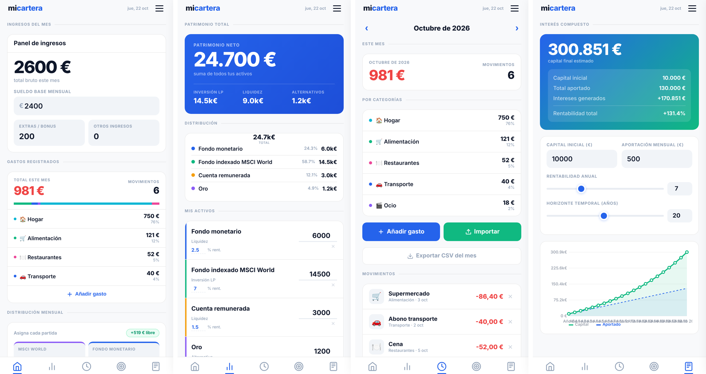

# miCartera

**Offline-first personal finance PWA** — budget allocation, expense tracking with bank-statement import and receipt OCR, net-worth dashboard and compound-interest simulator. Vanilla JavaScript, no build step, no backend, no tracking.


<sub>Screenshots with demo data. The UI is in Spanish.</sub>

## Features

- **Monthly allocation** — split income across index fund, money market, emergency fund and spending; free cash and savings rate update live from real expenses
- **Expense tracking** — categories, inline editing, month navigation, CSV export
- **Statement import** — XLSX, CSV and PDF from any bank, with automatic column detection (Spanish/English headers) and duplicate detection by description + amount + date
- **Receipt scanning** — camera capture + OCR (Tesseract.js) extracts amount, date and merchant
- **Net worth** — custom assets by type (cash / long-term investment / alternative) with donut chart
- **Savings goals** — progress and estimated time to completion
- **Compound-interest simulator** — initial capital, monthly contribution, annual return and horizon, with chart
- **Installable & offline** — Service Worker cache and Web App Manifest (iOS/Android)
- **Private by design** — all data stays in `localStorage`; JSON backup/restore from the side menu

## Tech

| Area | Choice |
|---|---|
| UI | HTML5, CSS3, vanilla JS — no framework, no bundler |
| Charts | Canvas API (hand-drawn donut and line chart) |
| Offline | Service Worker + Web App Manifest |
| Parsing | [SheetJS](https://sheetjs.com/) (XLSX), [PDF.js](https://mozilla.github.io/pdf.js/) (PDF) — lazy-loaded from CDN |
| OCR | [Tesseract.js](https://tesseract.projectnaptha.com/) — lazy-loaded on first scan |
| Storage | `localStorage` (key `micartera_v2`) |

## Project structure

```
├── index.html          # Markup only — no inline styles or scripts
├── manifest.json       # PWA manifest
├── sw.js               # Service Worker (offline cache)
├── css/app.css
└── js/
    ├── constants.js    # Formatting helpers, categories, global state
    ├── store.js        # localStorage persistence + JSON backup/restore
    ├── gastos.js       # Expenses: CRUD, rendering, month navigation
    ├── activos.js      # Assets: CRUD
    ├── objetivos.js    # Savings goals
    ├── simulador.js    # Compound-interest calculator + chart
    ├── csv.js          # CSV / XLSX / PDF import + receipt OCR
    └── app.js          # Navigation, allocation bar, donut, bootstrapping
```

## Run locally

```bash
python3 -m http.server 8080   # or: npx serve .
```

Open `http://localhost:8080`. The Service Worker registers on HTTPS or localhost; on iOS use *Share → Add to Home Screen* to install.

## How the metrics are computed

- **Free cash** = income − (index fund + money market + emergency fund) − actual expenses this month
- **Savings rate** = (income − actual expenses) / income × 100

## Statement import

| Format | Tested with |
|---|---|
| XLSX | BBVA (optimized), any bank with standard columns |
| CSV | Revolut, ING, N26 — `;`, `,` or TAB separators |
| PDF | Digital statements with real text (not scans) |

Only debits are imported; metadata rows are skipped automatically.

## Open Banking (PSD2) — prepared, disabled

Bank sync via Open Banking is scaffolded in the code but hidden in the UI. To enable it:

1. Uncomment the `<!-- OPEN BANKING: descomentar... -->` block in `index.html` (Expenses section)
2. Change `display:none!important` to `display:flex` on the `bankModalBg` modal

The intended provider is **GoCardless Bank Account Data (Nordigen)**, free for personal use with 2,400+ European banks. It needs a small backend to hold the OAuth secrets — the browser never sees them.

### Architecture

```
[Bank] ← OAuth PSD2 → [Backend Node/Python] ← HTTPS → [miCartera PWA]
```

### Minimal backend (Node.js)

```bash
npm install node-fetch express
```

```js
import express from 'express';
import fetch from 'node-fetch';

const app = express();
const BASE       = 'https://bankaccountdata.gocardless.com/api/v2';
const SECRET_ID  = process.env.NORDIGEN_SECRET_ID;
const SECRET_KEY = process.env.NORDIGEN_SECRET_KEY;

app.get('/token', async (req, res) => {
  const r = await fetch(`${BASE}/token/new/`, {
    method: 'POST',
    headers: { 'Content-Type': 'application/json' },
    body: JSON.stringify({ secret_id: SECRET_ID, secret_key: SECRET_KEY }),
  });
  res.json(await r.json());
});

app.get('/transactions/:accountId', async (req, res) => {
  const { access_token } = req.query;
  const r = await fetch(`${BASE}/accounts/${req.params.accountId}/transactions/`, {
    headers: { Authorization: `Bearer ${access_token}` },
  });
  res.json(await r.json());
});

app.listen(3000);
```

## License

MIT
